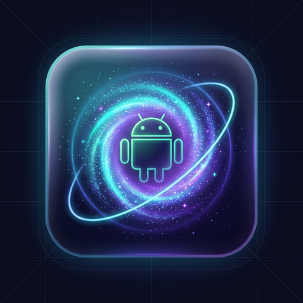

# Galaxy Android

<p align="center">
  
</p>

[](LICENSE)
[](docs/TECHNICAL.md)
[-orange.svg)](docs/TECHNICAL.md)
[](docs/TECHNICAL.md)
[](https://github.com/OpenPort-Labs/Galaxy-Android/releases/tag/v0.0.1b)

**Play the classic 3D cosmic gravity platformer natively on your Android phone, tablet, or handheld console.**

**Galaxy Android** is a **100% native Android ARM64 port**, compiled directly from reconstructed C++ source code. Maintained by [OpenPort Labs](https://github.com/OpenPort-Labs/Galaxy-Android).

It is **not an emulator**: the game code executes natively on your phone's processor using OpenGL ES 3.2 (with experimental Vulkan 1.1) and AAudio, delivering fluid 60 FPS performance, low battery consumption, and zero emulation overhead.

---

## Acknowledgements & Deep Gratitude

This project is made possible through the pioneering work of the community:

- **[bigmak94 / GalaxyQuest](https://github.com/bigmak94/GalaxyQuest)**: For the standalone mobile/ARM port architecture, memory reservation shims, and the little-endian asset cooker toolchain.
- **[Petari Decompilation Project](https://github.com/SMGCommunity/Petari)**: For the reverse-engineering and C++ decompilation research.

We express our deepest thanks to both projects and their contributors for keeping game preservation alive.

---

## Key Features

### ⚡ Quick Save Anywhere
- Save your game progress at any point during gameplay without returning to the Comet Observatory or waiting for a level-complete star!
- Accessible directly from the slide-out **Settings Drawer** (`⚙` -> **⚡ Quick Save Anywhere**) with a floating animated on-screen HUD toast (`"Game Progress Saved Anywhere!"`).
- Safely writes full user file data, star bit counts, coin tallies, comet timers, and unlocked galaxies directly to internal NAND storage.

### 🌋 Dual Graphics Pipeline: OpenGL ES 3.2 (Stable) & Vulkan 1.1 (Experimental WIP)
- **OpenGL ES 3.2 Backend (Default & Recommended)**: Production-ready renderer featuring dynamic TEV stage compilation, Mali & Adreno lighting safeguards, non-zero vector normalization guards, and indirect texture coordinate warping.
- **Vulkan 1.1 Hardware Backend (Experimental WIP)**: Next-generation low-overhead Vulkan backend. Hardware probing, swapchain management, dynamic depth format selection, and fence synchronization are in place; full GX draw record playback is actively in progress.

### 🎮 Comprehensive Gamepad & Handheld Console Support
- Native plug-and-play support for Bluetooth and USB gamepads (Xbox Wireless, PlayStation DualSense / DualShock 4, Switch Pro, Razer Kishi, Backbone One, etc.).
- Manifest declarations configured with `android.hardware.touchscreen` optional (`required="false"`) and `android.hardware.gamepad` enabled, ensuring complete compatibility with Android TV, dedicated handhelds (Odin, Retroid Pocket, Logitech G Cloud), and external monitors.

### 📱 Frosted Glass Minimalist Touch Controls
- **Sleek Translucent Dark Glass Theme**: Semi-transparent frosted glass backplates with ultra-thin luminous perimeter rings and tactile depression feedback.
- **Dynamic Luminous Laser Tether Joystick**: Vector laser line connects the stick origin to your thumb knob, providing immediate visual feedback of analog magnitude and deflection angle. Supports dynamic floating stick anchor mode.
- **Directional Camera D-Pad**: Unibody circular navigation disc replicating the controller D-Pad for 45° camera rotation and recentering.
- **Direct 1:1 Star Pointer Finger Tracking**: Touch and drag anywhere on screen to collect and aim star bits without accidental joystick conflicts.

### 📐 True Native Hor+ Ultrawide (No Stretch, No Zoom)
- Dynamically adapts the 3D camera projection to modern mobile aspect ratios (such as 19.5:9, 20:9, and foldable aspect ratios).
- Horizontally expands field of view (Hor+) so you see more of the cosmos around the player without vertical cropping.
- Keeps 2D HUD elements (health meter, coin counters, star bit count, dialogs) centered in a 16:9 safe zone so circular UI elements remain perfect circles and are never obscured by camera hole-punch cutouts or rounded screen corners.

### ⚙ Google Material 3 Settings Drawer
- Slide-out drawer docked cleanly on the top-left edge of the screen (`⚙`).
- Native Hor+ Ultrawide toggle, button opacity, button scaling, joystick modes, drag-and-drop touch layout editor, and **Quick Save Anywhere**.
- Built-in gameplay options and accessibility settings.

### Cinematic Cutscenes & Low-Latency Audio
- Software-decoded THP video playback for the prologue and ending cinematics.
- Real-time DSP mixer running through Android's low-latency AAudio subsystem.

---

## System Requirements

| Specification | Minimum Requirement | Recommended |
|---|---|---|
| **Operating System** | **Android 11 or newer (API Level 30+)** | Android 12, 13, 14, or 15 |
| **CPU Architecture** | 64-bit ARM (`arm64-v8a`) | 64-bit ARM (`arm64-v8a`) |
| **Graphics API** | OpenGL ES 3.2 | OpenGL ES 3.2 |
| **Audio Subsystem** | AAudio | AAudio |
| **RAM** | 3 GB | 4 GB or higher |
| **Storage** | ~2.5 GB (without movies) / ~5 GB (with movies) | Fast UFS internal storage |

---

> [!IMPORTANT]
> **Legal Notice:**
> **You must provide your own legally dumped copy of the original optical disc.** Neither this repository nor the compiled APK contains any copyrighted game assets, levels, audio, textures, or cinematics. You extract and convert your own legally owned disc once on your phone or PC.

---

## Quick Start: How to Run on Android

For detailed instructions, see the complete [Installation Guide](docs/INSTALLATION.md).

### 1-Step Setup on Your Phone

With the unified **GalaxyAndroid** package:

1. **Place your game dump on your phone**:
   - Copy your legally dumped optical disc image (`.rvz`, `.wbfs`, `.iso`, or `.wia`) into your phone's **`Download`** folder.
2. **Install the unified APK**:
   - Install **`GalaxyAndroid.apk`**.
3. **Launch & Play**:
   - Enjoy native 60 FPS gameplay on Android!

---

## Documentation

- [Controls & Input Reference](docs/CONTROLS.md) - Touch overlay, pointer aim, and gamepad layouts
- [Technical Architecture](docs/TECHNICAL.md) - 32-bit address space reservation, GLES 3.2 translation, and Hor+ ultrawide
- [Installation Guide](docs/INSTALLATION.md) - Comprehensive setup instructions
- [Desktop Pipeline Guide](docs/DESKTOP_INSTALLER.md) - Automated PC extraction and conversion
- [Decompilation Notes](docs/decomp/getting_started.md) - Decompilation symbol mappings and splits

---

## Building from Source

### Requirements
- Android NDK `r25` or `r26`
- Android SDK (API 30+ and Build-Tools 34+)
- CMake 3.22+ and Ninja
- JDK 17+ and Python 3.8+

### Native Library & Packaging
```bash
# 1. Compile native engine library (libgame.so)
cmake --build build-mobile --target game

# 2. Package and sign APK
python package_mobile_apk.py
```
The output APK is generated at `out-mobile/GalaxyAndroid.apk`.

---

## License

This project is licensed under the **GNU General Public License v3.0 (GPL-3.0)**. See the [`LICENSE`](LICENSE) file for details.
